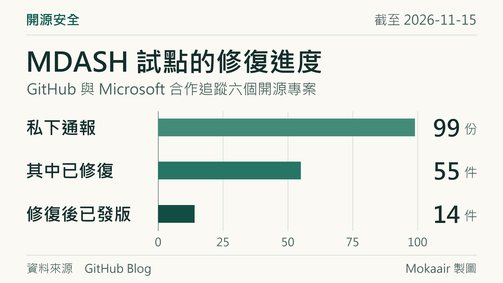
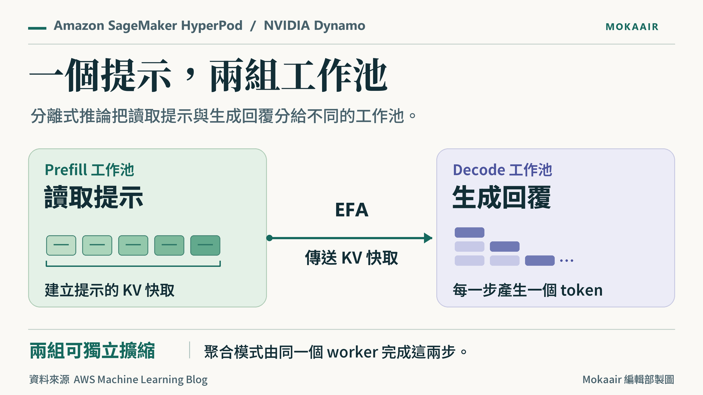

# 科技與 AI 新聞選圖指南

## 一張圖要回答哪個問題？

2026-11-18 抽查 Mokaair 繁中站的 AI 與科技分類，各取前五個不同的文章連結。十篇文章的初始 HTML 都沒有圖片元素，分享預覽也都指向同一張 `/og.png`。優先為讀者最需要看見細節的新聞配圖。[AI 分類](https://mokaair.com/zh-TW/life/topics/ai-news) · [科技分類](https://mokaair.com/zh-TW/life/topics/tech-news)

電腦王阿達的 GPT-6.2 報導使用六張不同的內文圖，數張緊接評測和成本段落。Gemini Notebook 教學則用八張圖串起輸入需求、生成網頁和操作計算器的過程。兩篇都讓讀者在剛讀到數字或動作時，就看見相應的畫面。[GPT-6.2 報導](https://www.kocpc.com.tw/archives/703800) · [Gemini Notebook 教學](https://www.kocpc.com.tw/archives/703889)

| 報導題材 | 選什麼圖 | 圖說要交代什麼 |
| --- | --- | --- |
| AI 模型發布、費率調整 | 依原始價目表或評測資料自製比較圖，並在正文保留數字 | 模型版本、日期、單位。價格分列輸入與輸出，評測寫明由誰執行 |
| 介面或功能更新 | 用測試帳號截取設定入口與操作結果，保留辨認位置所需的周邊畫面 | 選單路徑、測試版本與適用方案。發布前遮蔽個資、帳號和金鑰 |
| 晶片、裝置、規格更新 | 選用實拍細節或獲准刊登的產品照，例如能看清新接頭的位置與形狀 | 完整型號、拍攝者，以及畫面中能觀察到的變更 |
| 人事、政策或事件進展 | 有多個已核實的日期時，自製簡短時間軸。只有一項消息時，來源連結與清楚文字就足夠 | 為每個節點標日期和來源，將已公布的決議與預定事項分開 |

## 在文章草稿加圖

1. 確認素材可以用於新聞與分享預覽。自製圖留存原稿和資料來源。創作的情境示意圖在圖說標明用途，實拍與截圖則交代拍攝對象或版本。廠商圖、第三方圖片與產品截圖，核對素材使用條款或取得許可，留存原始頁與授權依據。逐張填 `credit.author`、`credit.license` 與可公開的 `credit.source_url`。圖表引用的數據另列在文章來源。
2. 把圖檔放在 `apps/web/public/guides/<slug>/`，檔名使用英文小寫、數字與連字號。草稿按「加入主圖」，在 `hero` 填入 `/guides/<slug>/<檔名>`、實際寬高、替代文字及來源。主圖支援 JPG、PNG、WebP。優先選用能在手機縮圖辨識主體、寬至少 1200 像素的橫圖，適合時採 16:9 構圖，例如 1280 × 720。[Google Discover 圖片指引](https://developers.google.com/search/docs/appearance/google-discover)
3. 選「新增區塊」的「圖片」，將圖片區塊移到需要說明的段落後，填寫 `ImageBlock` 的圖片路徑、寬高、替代文字、圖說和來源。替代文字描述畫面，例如「隱私設定頁展開資料使用選單」。圖說補充讀者要知道的條件，例如「測試版本需展開進階設定才看得到此選項」。各語言草稿分別寫替代文字與圖說，圖內有文字時也核對語言。用手機預覽主圖裁切、圖中文字和來源連結。[五語文章範例](../../apps/api/app/guides/content/ai-news-chatgpt-images-25-20260908.json) · [Google 圖片 SEO 指引](https://developers.google.com/search/docs/appearance/google-images)

## MDASH 試點圖表的入稿範例

這張繁中圖供編輯預覽，尚未刊入正式文章。可放在解釋修復進度的段落後，讓讀者看出「修好」和「使用者已能取得更新」之間還隔了一個發版步驟。

- **圖片路徑與尺寸**　`/guides/tech-news-github-microsoft-mdash-open-source-fixes-20261117/mdash-pilot-zh-tw.png`，1600 × 900。
- **替代文字**　截至 2026-11-15，六個開源專案收到 99 份私下通報，其中 55 件已修復，這些修正中有 14 件已隨版本發布。
- **圖說**　GitHub 與 Microsoft 的 MDASH 試點追蹤六個開源專案。三條橫條共用零點，後兩列分別顯示上一列中已修復、已發版的部分。
- **製圖與數據來源**　`credit.author` 填 Mokaair，`credit.license` 填 © Mokaair，本站原創圖的 `credit.source_url` 填 `null`。文章來源另填 GitHub Blog 的試點說明，查核日為 2026-11-18。[GitHub Blog 原始報告](https://github.blog/open-source/maintainers/maintainers-dont-need-more-ai-bug-reports-they-need-fixes/)

## Dynamo 分離式推論的入稿範例

這張繁中圖適合放在報導首次解釋 Prefill、Decode 與快取傳輸的段落旁。讀者可以沿著箭頭看出兩組工作池怎麼銜接。它是依原文繪製的架構示意圖，目前供編輯預覽。[AWS 架構說明](https://aws.amazon.com/blogs/machine-learning/managed-nvidia-dynamo-on-amazon-sagemaker-hyperpod-inference/)

- **圖檔**　`/guides/ai-news-sagemaker-hyperpod-nvidia-dynamo-20261117/dynamo-inference-zh-tw.png`，1600 × 900。
- **替代文字**　Prefill 工作池讀取提示，透過 EFA 將 KV 快取傳給逐步生成回覆的 Decode 工作池。
- **圖說**　NVIDIA Dynamo 把提示處理與回覆生成分給兩組工作池，兩者能依需求各自擴縮。
- **製圖與資料來源**　`credit.author` 填 Mokaair，`credit.license` 填 © Mokaair，`credit.source_url` 填 `null`。文章的來源欄保留 AWS Machine Learning Blog，查核日為 2026-11-18。

## 怎麼知道讀者有沒有點？

站內若要測量分類卡片點閱率，先讓讀者選擇是否同意分析。只計同意者實際看到的卡片，同一次瀏覽中同一卡位的同一篇文章，曝光與點入各計一次。以有點入的曝光次數除以總曝光次數，記下日期、版位、曝光量與點入量。僅有點擊數時可報告點擊次數。閱讀完成與回訪需要各自的觀察資料。

站外則分別查看 Search Console 的搜尋結果與 Discover，在各自的報表比較相同期間、同一分類文章的點擊、曝光及點閱率。比較圖片調整前後時一併記錄重大新聞與標題變動。Discover 報表達到 Google 的曝光門檻後才會出現。[Search Console 成效說明](https://support.google.com/webmasters/answer/10268906?hl=zh-Hant) · [Discover 成效報表](https://support.google.com/webmasters/answer/9216516?hl=zh-Hant)
